<div align="center">
  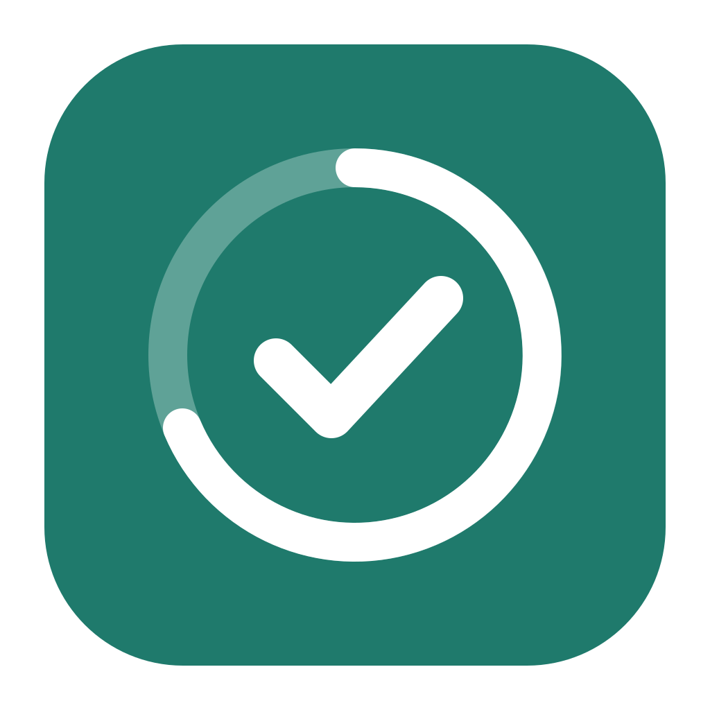
  <h1>Sachiva</h1>
  <h4>A calm desk assistant for admin work: what to do next, why, and reminders that keep going until it is done.</h4>

  <a href="LICENSE"></a>
  
  

  <p>
    <a href="#-what-it-does">What it does</a> •
    <a href="#-get-started">Get started</a> •
    <a href="#-how-it-works">How it works</a> •
    <a href="#-faq-and-troubleshooting">FAQ</a> •
    <a href="#%EF%B8%8F-for-developers">For developers</a>
  </p>

  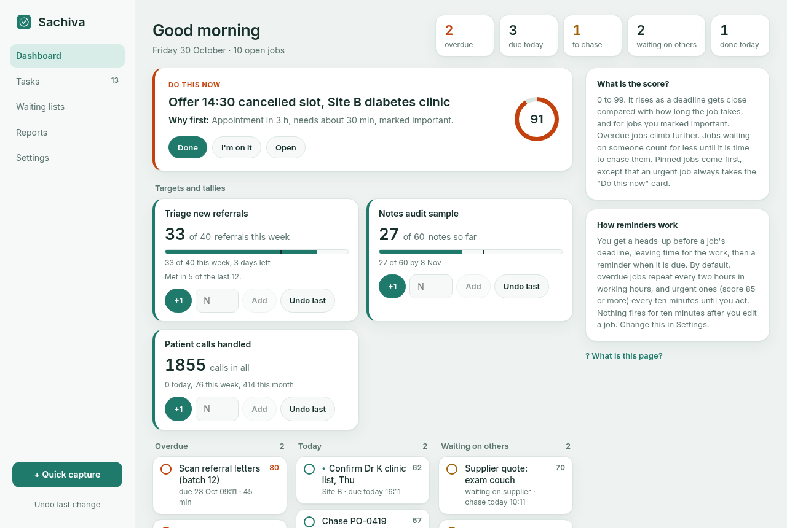
</div>

Sachiva (सचिव, "secretary") is for one person who runs the admin side of a busy service: clinics across
sites, bookings, orders, deliveries and follow-ups. It ranks your jobs, says in plain words why one comes
first, and keeps reminding you until it is done.

It is built for confidential settings. It holds **reference codes only**, never patient details, and it
warns you if something you type looks like a health number, phone number, birth date or address.

> [!NOTE]
> Sachiva is in early development (alpha). Keep the recovery key it gives you on paper, and expect
> changes. See the [CHANGELOG](CHANGELOG.md).

## ✨ What it does

- 🎯 **Do this now** – one card shows the job to do next, with a score and the reason, such as "Due in 3 h,
  needs about 30 min, marked important."
- 🗂️ **Lanes for the day** – Overdue, Today, and Waiting on others, updated by themselves as time passes.
- 🔔 **Reminders that keep going** – a heads-up before the deadline, a "due now", then repeats until you act.
  Urgent jobs repeat every ten minutes. Nothing nags you right after an edit or outside working hours.
- ⏳ **Waiting on others** – hand a job to a supplier or a colleague and set a date to chase them.
- 🔁 **Repeating jobs and checklists** – weekly stock checks, month-end returns, every few days after it was
  last done.
- 🔢 **Targets and tallies** – "40 referrals a week" or "60 notes by Friday", with a progress bar and a nudge
  when you fall behind. Or just count: calls, bookings, work-queue items sorted. Press **+1** as you go.
- 📋 **Waiting lists** – enter each list's figures daily, weekly or monthly: how many wait, joined, left and
  were booked, how long they wait (in bands), and the longest wait. Split by site, clinic and provider.
- 📊 **Reports** – charts in the "Making Data Count" style used across health services, which show real
  change apart from ordinary ups and downs. Save them as Excel, Word, PowerPoint or PDF.
- 🛡️ **Confidentiality check** – warns, before you keep a job, if the text may identify a person.
- ↩️ **Undo and trash** – undo any change; deleted jobs stay restorable for 30 days.
- 🔒 **Encrypted and offline** – your data stays on your device in an encrypted database, with a daily backup.
- 💾 **Backup and restore** – see what a backup holds before restoring it; export a copy locked with a passphrase.
- ⬆️ **Careful updates** – checks at start, asks first, backs up first, and lets you go back a version.

## 📸 Screenshots

<table>
  <tr>
    <td>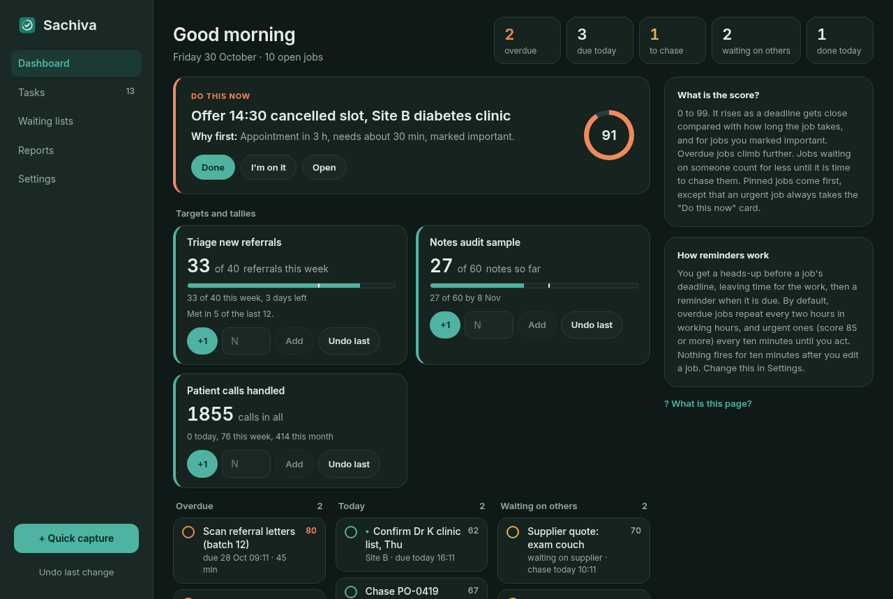</td>
    <td>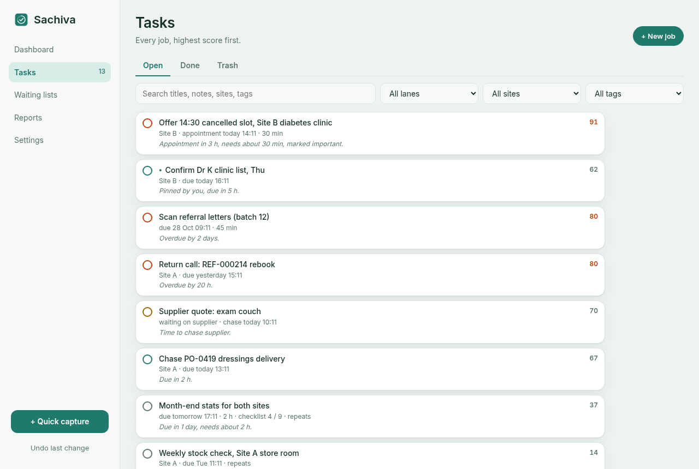</td>
    <td>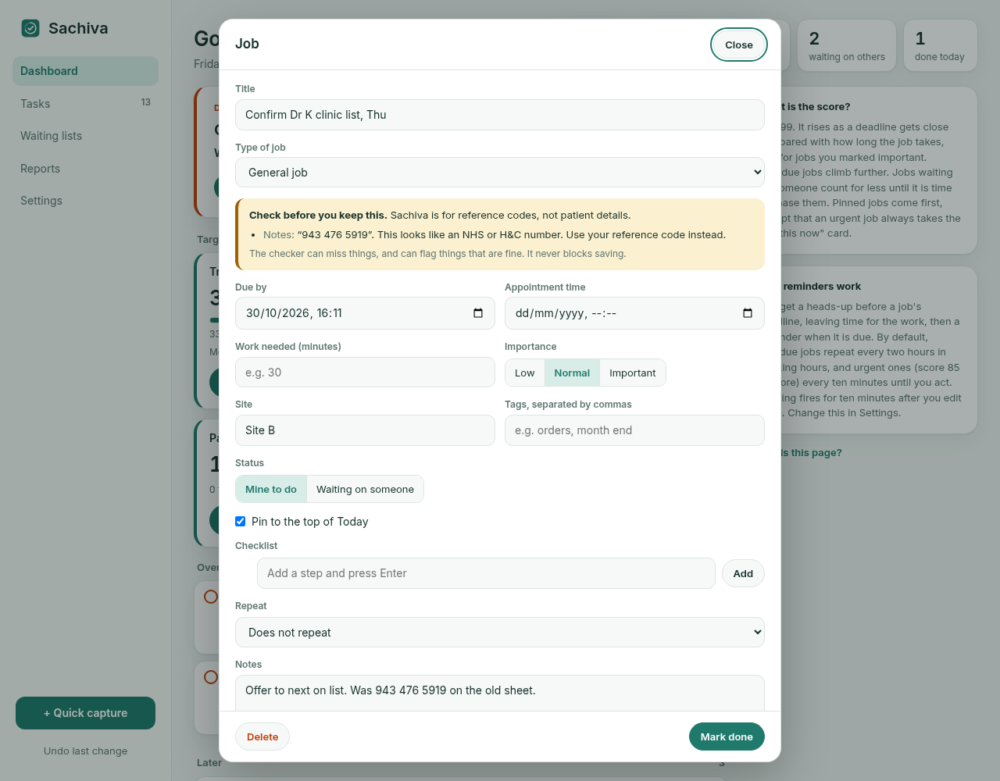</td>
  </tr>
  <tr>
    <td align="center">Dark mode</td>
    <td align="center">Every job, with filters</td>
    <td align="center">The checker at work</td>
  </tr>
  <tr>
    <td>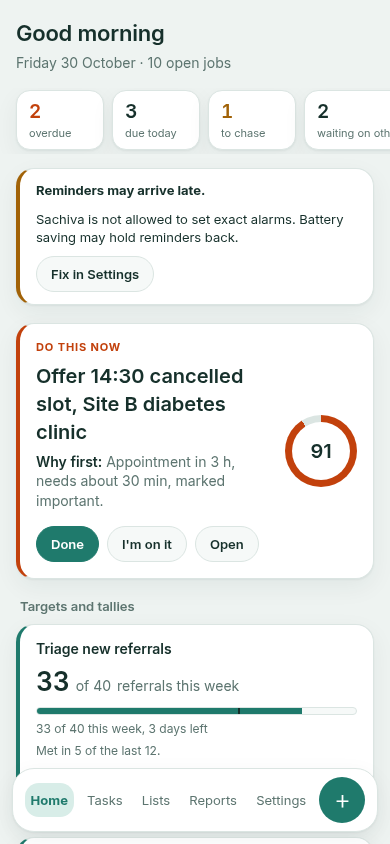</td>
    <td>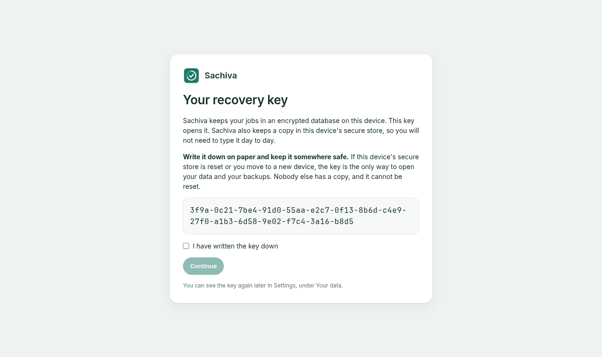</td>
    <td>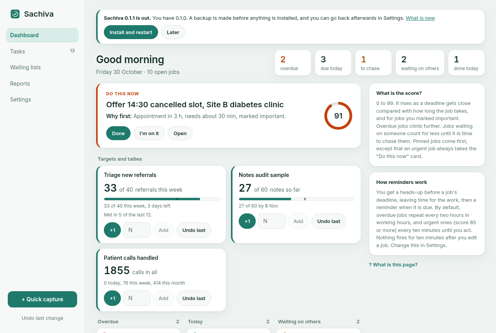</td>
  </tr>
  <tr>
    <td align="center">On a phone</td>
    <td align="center">Your recovery key</td>
    <td align="center">Asks before updating</td>
  </tr>
  <tr>
    <td></td>
    <td>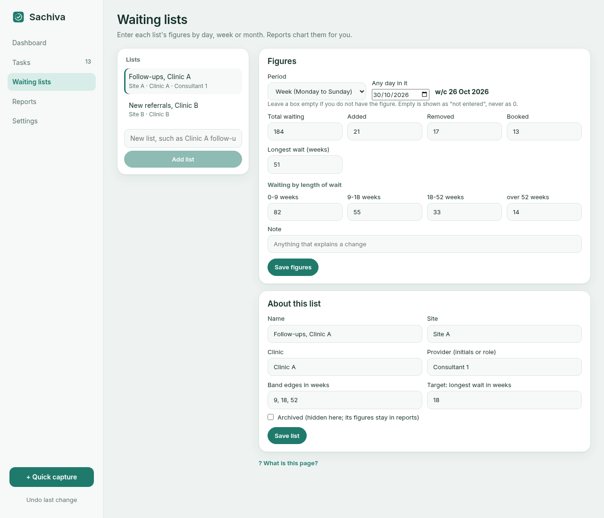</td>
    <td>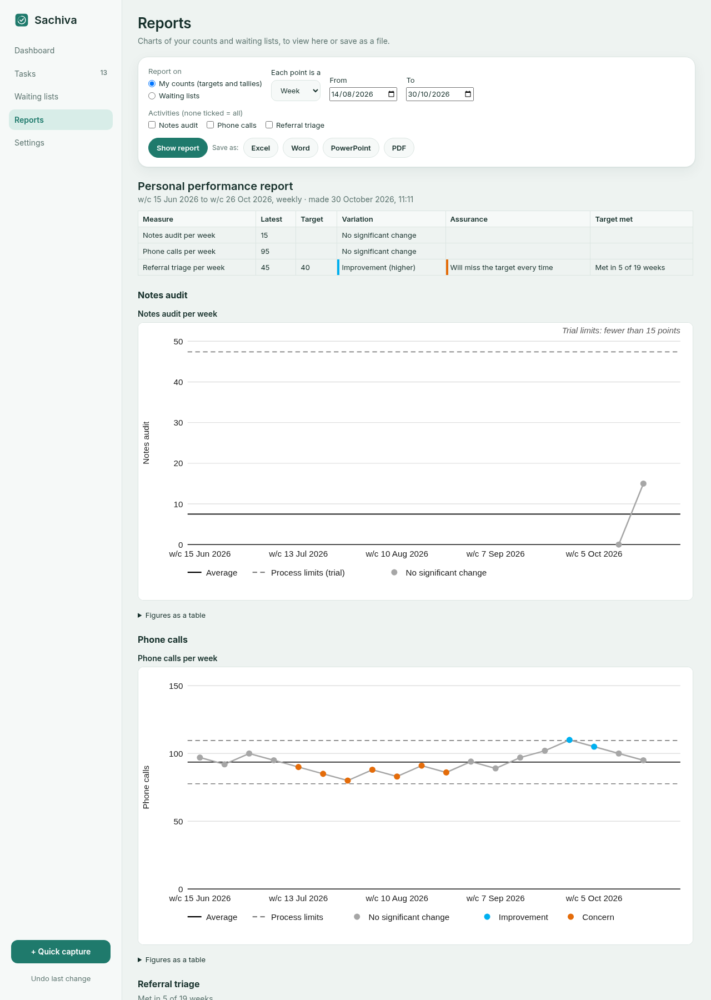</td>
  </tr>
  <tr>
    <td align="center">Targets and tallies</td>
    <td align="center">Waiting-list figures</td>
    <td align="center">Reports</td>
  </tr>
</table>

All screenshots use made-up demo data.

## 🚀 Get started

Download from the [latest release](https://github.com/sudharamachandranrajeev/sachiva/releases/latest). Pick the file for your device:

| Device | File | Updates itself |
| --- | --- | --- |
| Windows 10 or 11 | `Sachiva_<version>_x64-setup.exe` | Yes |
| Windows, no install | `Sachiva_<version>_x64_portable.zip` | No: it tells you when a new version is out |
| Linux, any | `Sachiva_<version>_amd64.AppImage` | Yes |
| Arch Linux | `sachiva-<version>-1-x86_64.pkg.tar.zst` | Yes, through pacman |
| Android 8 or newer (64-bit) | `Sachiva_<version>_aarch64.apk` | Yes, after you confirm |

<details>
<summary><b>Windows installer</b></summary>

1. Download `Sachiva_<version>_x64-setup.exe`.
2. Open it. Windows may say "Windows protected your PC", because Sachiva has no paid code-signing
   certificate. Choose **More info**, then **Run anyway**.
3. It installs for your Windows account only, with no admin password, into
   `%LOCALAPPDATA%\Programs\Sachiva`, and adds Sachiva to the Start menu.
4. To remove it: **Settings** → **Apps** → **Sachiva** → **Uninstall**. Your data stays in
   `%APPDATA%\dev.sachiva.sachiva` until you delete that folder.
</details>

<details>
<summary><b>Windows portable</b></summary>

1. Download `Sachiva_<version>_x64_portable.zip` and unzip it anywhere, for example on a USB stick.
2. Open `sachiva.exe` in the `Sachiva` folder. The same Windows warning as above may appear.
3. Your data is kept in your Windows profile, not in the folder. When Sachiva says a new version is
   out, download the new zip and replace the files in the folder.
</details>

<details>
<summary><b>Linux: AppImage</b></summary>

1. Download `Sachiva_<version>_amd64.AppImage`.
2. Make it runnable: `chmod +x Sachiva_*_amd64.AppImage`
3. Run it: `./Sachiva_*_amd64.AppImage`

It needs FUSE 2 (`libfuse2` on Debian and Ubuntu, `fuse2` on Arch).
</details>

<details>
<summary><b>Arch Linux package</b></summary>

1. Download `sachiva-<version>-1-x86_64.pkg.tar.zst`.
2. Install it: `sudo pacman -U sachiva-*-x86_64.pkg.tar.zst`
3. Open Sachiva from the app menu.

Updates install through pacman too: Sachiva asks for your password through the system prompt.
To remove it: `sudo pacman -R sachiva`. Your data stays in `~/.local/share/dev.sachiva.sachiva`.
</details>

<details>
<summary><b>Android</b></summary>

1. On the phone, download `Sachiva_<version>_aarch64.apk`.
2. Open it. Android asks to allow installing from your browser or file app: allow it for this once.
3. Open Sachiva. Allow notifications, exact alarms and unrestricted battery use when asked.
</details>

<details>
<summary><b>Check a download (optional)</b></summary>

Each release has `SHA256SUMS.txt`. Compare its line for your file with:

- Windows: `certutil -hashfile <file> SHA256`
- Linux: `sha256sum <file>`

If they differ, do not open the file. Download it again.
</details>

**First launch**

1. Sachiva shows your **recovery key**: 64 letters and digits in groups of four.
2. Write it down on paper. Tick **I have written the key down**, then press **Continue**.
3. Press **+ Quick capture** (or the **N** key), type a job and press **Enter**.
4. Click the job to add a deadline, how long it takes, a site, a checklist or a repeat.

On a computer, Sachiva starts with the computer and lives in the tray, so reminders arrive with the window
closed. On Android, open **Settings** and allow **exact alarms** and **unrestricted battery use**, or
reminders may come late.

## 🧭 How it works

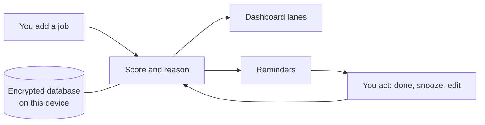

- The **score** (0 to 99) rises as the deadline gets close compared with how long the job takes. Important
  jobs get more; overdue jobs climb further. Pinned jobs come first,
  but an urgent job always takes the **Do this now** card.
- Jobs **waiting on someone** count for less until it is time to chase them.
- **Reminders** are worked out from the same rules, so the dashboard and your notifications always agree.
- Every number on the dashboard explains itself: tap it.

### Targets, waiting lists and reports

**Keep a count**

1. Open a job (or make one) and set **Type of job** to **Target** or **Tally**.
2. For a target, give the number, what you count (such as "referrals") and how often: per day, week or
   month, or once by the job's due date.
3. On the dashboard, press **+1** each time, or type a number and press **Add**. **Undo last** takes the last
   entry back. Nothing is erased: a correction is a new entry, so the record stays complete.
4. A target that falls behind an even pace says **Behind**, and Sachiva reminds you during working hours.

**Keep waiting-list figures**

1. Open **Waiting lists** and add a list, such as "Follow-ups, Clinic A".
2. Under **About this list**, add the site, clinic and provider (initials or a role, never a name), the
   wait bands in weeks (for example `9, 18, 52`) and, if you have one, a target for the longest wait.
3. Under **Figures**, pick **Day**, **Week** or **Month** and any day in that period, fill in what you
   have and press **Save figures**. Leave a box empty if you do not know it: empty means "not entered",
   never 0.

**Make a report**

1. Open **Reports**. Choose **My counts** or **Waiting lists**, how long each point is, and the dates.
2. Press **Show report** to see it, or **Excel**, **Word**, **PowerPoint** or **PDF** to save a file.

How to read the charts:

- Each chart shows the figures, their average (solid line) and process limits (dashed lines).
- A **blue** point is a real change for the better, an **orange** point a real change for the worse,
  and a **grey** point ordinary variation.
- With fewer than 15 points the limits are marked as trial limits.
- The red line is the target. **Assurance** says if the target will be met every time, never, or
  only sometimes.
- The week or month still running is left out of the chart (a part-week would look like a fall). The
  table shows it as "so far".

The files carry no logos. The PDF is tagged for screen readers (PDF/UA), and every chart has a text
description.

## 🔒 Your data

- Everything stays on your device. Sachiva sends nothing anywhere and needs no account.
- The database is encrypted (SQLCipher). Its key is kept in your computer's password store, or in the
  phone's secure key store on Android.
- A backup is made once a day; the last 14 are kept, encrypted with the same key.
- Sachiva also backs up before every update and every restore.
- Settings → **Your data** lists your backups. Press **Restore…** on one to see what it holds first; your
  current data is backed up before it is replaced.
- **Export a copy…** saves a file locked with a passphrase you choose, for moving to another device.
  **Restore from a file…** opens it there.

## ⬆️ Updates

- At start, Sachiva checks for a new version (it sends nothing about you or your jobs). If there is one,
  it shows what is new and asks. Nothing installs until you press **Install and restart**.
- Before installing, it backs up your data. Every download is checked against Sachiva's signature, so a
  damaged or altered file is refused.
- Changed your mind? Settings → **Updates** → **Go back to** the version you had before. If that version
  cannot read today's data, Sachiva tells you and uses the backup from before the update.
- On Android, the phone itself asks you to confirm the update. Android cannot go back a version; the
  backups from before each update stay available.
- Turn checking off in Settings → **Updates**.

> [!IMPORTANT]
> The recovery key is the only way to open your data if the device's key store is reset. Nobody else has a
> copy, and it cannot be reset. Keep it on paper.

## ❓ FAQ and troubleshooting

<details>
<summary>Sachiva says it is locked</summary>

The key on this device could not be read, for example after the password store was reset. Enter the
recovery key you wrote down. Your data has not been changed.
</details>

<details>
<summary>Can I put patient names in a job?</summary>

No. Use the reference codes your service already uses. The checker warns about health numbers, phone
numbers, birth dates, postcodes, e-mail addresses, names with a title, and street addresses. It can miss
things, so it is a safety net, not a guarantee.
</details>

<details>
<summary>Reminders on my phone come late</summary>

Open **Settings** → **Alarms on this phone** and allow both. Some phones also stop apps in the background:
look for "battery optimisation" or "app sleep" in the phone's settings. Reminders are planned three days
ahead, so open Sachiva at least every few days.
</details>

<details>
<summary>I closed the window and reminders stopped</summary>

Closing the window keeps Sachiva in the tray. **Quit** from the tray icon stops it. If you quit, start it
again from the app menu.
</details>

<details>
<summary>An update went wrong</summary>

Open Settings → **Updates** → **Go back to** the previous version. Then tell us with **Report a problem**
in Settings. It opens a GitHub form with the version and recent error messages filled in, and no job text.
</details>

<details>
<summary>Windows says "Windows protected your PC"</summary>

This warning appears for programs without a paid code-signing certificate. Choose **More info**, then
**Run anyway**. To be sure the file is genuine, check it against `SHA256SUMS.txt` (see Get started).
</details>

<details>
<summary>Why did a job jump to the top?</summary>

Scores move with the clock. Open the job, or hover it in **Tasks**, to read the reason.
</details>

## 🛠️ For developers

<details>
<summary>Build, test and screenshots</summary>

You need Rust (stable), Node.js 22, and on Linux the WebKitGTK 4.1, libayatana-appindicator and librsvg
development packages.

```bash
cd app
npm ci
npm run tauri dev           # run with live reload
npm run tauri build         # installers for this computer
```

Checks:

```bash
cargo test --workspace
cargo clippy --workspace --all-targets -- -D warnings
(cd app && npm run check)
scripts/check-public.sh     # leak scan before any commit or push
scripts/screenshots.sh      # re-render docs/screenshots from demo data
```

Layout:

| Folder | What is in it |
| --- | --- |
| `core/` | The rules, in Rust: jobs, score, repeats, reminders, counts, waiting lists, control charts, checker, encrypted store, backups |
| `export/` | Writes reports as Excel, Word, PowerPoint and PDF, and draws the charts |
| `app/src-tauri/` | The app shell: commands, tray, reminder timer, Android alarms |
| `app/src/` | The screens (Svelte) |
| `plugins/device/` | Keeping the database key safe on each platform, Android alarm settings |
| `app/harness/` | Fakes the app shell so screenshots run in a browser with demo data |
| `packaging/` | The Arch package recipe and the portable version's read-me |

Android and Windows builds run in GitHub Actions ([ci.yml](.github/workflows/ci.yml)).
</details>

<details>
<summary>Making a release</summary>

1. Set the same version in `app/src-tauri/tauri.conf.json`, `app/src-tauri/Cargo.toml` and
   `app/package.json`, and add a `## [<version>]` section to `CHANGELOG.md`.
2. Commit, tag `v<version>`, push the tag.
3. [release.yml](.github/workflows/release.yml) runs all checks, then waits for the owner's approval
   (the `release` environment holds the signing keys and accepts only `v*` tags).
4. It builds every file into a **draft** release, signs them, writes `latest.json` and
   `SHA256SUMS.txt`, and checks the signatures, the APK certificate and that the AppImage starts.
5. The owner reads the draft and publishes it. Apps see the update once it is published.

The Arch package is built from [packaging/arch/PKGBUILD](packaging/arch/PKGBUILD).
</details>

## Licence

MIT. See [LICENSE](LICENSE).

> GitHub [@sudharamachandranrajeev](https://github.com/sudharamachandranrajeev)
