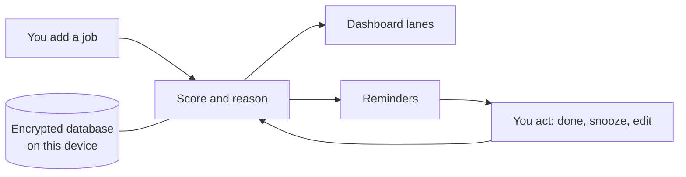

<div align="center">
  
  <h1>Sachiva</h1>
  <h4>A calm desk assistant for admin work: what to do next, why, and reminders that keep going until it is done.</h4>

  <a href="LICENSE"></a>
  
  

  <p>
    <a href="#-what-it-does">What it does</a> •
    <a href="#-get-started">Get started</a> •
    <a href="#-how-it-works">How it works</a> •
    <a href="#-faq-and-troubleshooting">FAQ</a> •
    <a href="#%EF%B8%8F-for-developers">For developers</a>
  </p>

  
</div>

Sachiva (सचिव, "secretary") is for one person who runs the admin side of a busy service: clinics across
sites, bookings, orders, deliveries and follow-ups. It ranks your jobs, says in plain words why one comes
first, and keeps reminding you until it is done.

It is built for confidential settings. It holds **reference codes only**, never patient details, and it
warns you if something you type looks like a health number, phone number, birth date or address.

> [!NOTE]
> Sachiva is in early development (alpha). There are no installers yet: the first release comes with the
> next phase. See the [CHANGELOG](CHANGELOG.md).

## ✨ What it does

- 🎯 **Do this now** – one card shows the job to do next, with a score and the reason, such as "Due in 3 h,
  needs about 30 min, marked important."
- 🗂️ **Lanes for the day** – Overdue, Today, and Waiting on others, updated by themselves as time passes.
- 🔔 **Reminders that keep going** – a heads-up before the deadline, a "due now", then repeats until you act.
  Urgent jobs repeat every ten minutes. Nothing nags you right after an edit or outside working hours.
- ⏳ **Waiting on others** – hand a job to a supplier or a colleague and set a date to chase them.
- 🔁 **Repeating jobs and checklists** – weekly stock checks, month-end returns, every few days after it was
  last done.
- 🛡️ **Confidentiality check** – warns, before you keep a job, if the text may identify a person.
- ↩️ **Undo and trash** – undo any change; deleted jobs stay restorable for 30 days.
- 🔒 **Encrypted and offline** – your data stays on your device in an encrypted database, with a daily backup.

## 📸 Screenshots

<table>
  <tr>
    <td></td>
    <td></td>
    <td></td>
  </tr>
  <tr>
    <td align="center">Dark mode</td>
    <td align="center">Every job, with filters</td>
    <td align="center">The checker at work</td>
  </tr>
  <tr>
    <td></td>
    <td></td>
    <td></td>
  </tr>
  <tr>
    <td align="center">On a phone</td>
    <td align="center">Your recovery key</td>
    <td></td>
  </tr>
</table>

All screenshots use made-up demo data.

## 🚀 Get started

Installers for Windows, Linux and Android arrive with the first release. Until then, you can build Sachiva
yourself: see [For developers](#%EF%B8%8F-for-developers).

**First launch**

1. Sachiva shows your **recovery key**: 64 letters and digits in groups of four.
2. Write it down on paper. Tick **I have written the key down**, then press **Continue**.
3. Press **+ Quick capture** (or the **N** key), type a job and press **Enter**.
4. Click the job to add a deadline, how long it takes, a site, a checklist or a repeat.

On a computer, Sachiva starts with the computer and lives in the tray, so reminders arrive with the window
closed. On Android, open **Settings** and allow **exact alarms** and **unrestricted battery use**, or
reminders may come late.

## 🧭 How it works



- The **score** (0 to 99) rises as the deadline gets close compared with how long the job takes. Important
  jobs get more; overdue jobs climb further. Pinned jobs come first.
- Jobs **waiting on someone** count for less until it is time to chase them.
- **Reminders** are worked out from the same rules, so the dashboard and your notifications always agree.
- Every number on the dashboard explains itself: tap it.

## 🔒 Your data

- Everything stays on your device. Sachiva sends nothing anywhere and needs no account.
- The database is encrypted (SQLCipher). Its key is kept in your computer's password store, or in the
  phone's secure key store on Android.
- A backup is made once a day; the last 14 are kept, encrypted with the same key.
- Settings → **Your data** shows the backup folder and your recovery key.

> [!IMPORTANT]
> The recovery key is the only way to open your data if the device's key store is reset. Nobody else has a
> copy, and it cannot be reset. Keep it on paper.

## ❓ FAQ and troubleshooting

<details>
<summary>Sachiva says it is locked</summary>

The key on this device could not be read, for example after the password store was reset. Enter the
recovery key you wrote down. Your data has not been changed.
</details>

<details>
<summary>Can I put patient names in a job?</summary>

No. Use the reference codes your service already uses. The checker warns about health numbers, phone
numbers, birth dates, postcodes, e-mail addresses, names with a title, and street addresses. It can miss
things, so it is a safety net, not a guarantee.
</details>

<details>
<summary>Reminders on my phone come late</summary>

Open **Settings** → **Alarms on this phone** and allow both. Some phones also stop apps in the background:
look for "battery optimisation" or "app sleep" in the phone's settings. Reminders are planned three days
ahead, so open Sachiva at least every few days.
</details>

<details>
<summary>I closed the window and reminders stopped</summary>

Closing the window keeps Sachiva in the tray. **Quit** from the tray icon stops it. If you quit, start it
again from the app menu.
</details>

<details>
<summary>Why did a job jump to the top?</summary>

Scores move with the clock. Open the job, or hover it in **Tasks**, to read the reason.
</details>

## 🛠️ For developers

<details>
<summary>Build, test and screenshots</summary>

You need Rust (stable), Node.js 22, and on Linux the WebKitGTK 4.1, libayatana-appindicator and librsvg
development packages.

```bash
cd app
npm ci
npm run tauri dev           # run with live reload
npm run tauri build         # installers for this computer
```

Checks:

```bash
cargo test --workspace
cargo clippy --workspace --all-targets -- -D warnings
(cd app && npm run check)
scripts/check-public.sh     # leak scan before any commit or push
scripts/screenshots.sh      # re-render docs/screenshots from demo data
```

Layout:

| Folder | What is in it |
| --- | --- |
| `core/` | The rules, in Rust: jobs, score, repeats, reminders, checker, encrypted store, backups |
| `app/src-tauri/` | The app shell: commands, tray, reminder timer, Android alarms |
| `app/src/` | The screens (Svelte) |
| `plugins/device/` | Keeping the database key safe on each platform, Android alarm settings |
| `app/harness/` | Fakes the app shell so screenshots run in a browser with demo data |

Android and Windows builds run in GitHub Actions ([ci.yml](.github/workflows/ci.yml)).
</details>

## Licence

MIT. See [LICENSE](LICENSE).

> GitHub [@sudharamachandranrajeev](https://github.com/sudharamachandranrajeev)
