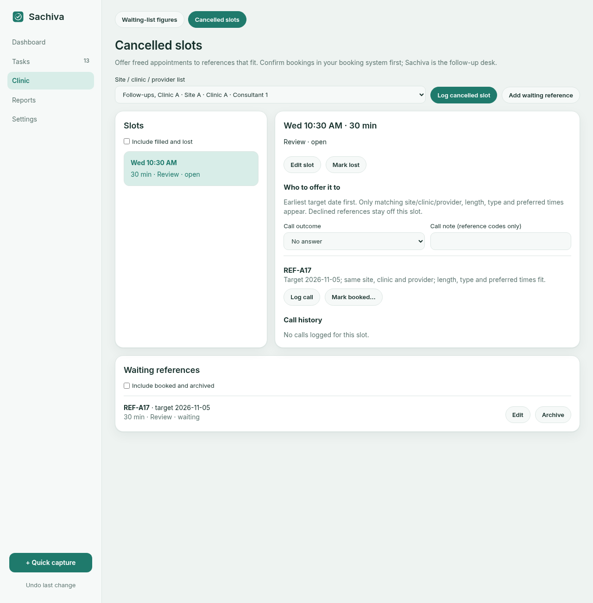

# Clinic desk

Phase 4 includes cancellation/refill, clinic sessions, procurement, deliveries
and reusable task/checklist templates. These are available in 0.3.0.

The official booking system remains the record. Sachiva holds reference codes
and follow-up work, never patient names, health numbers, dates of birth or contact
details. The confidentiality checker warns but cannot catch everything.

## Fill a cancellation

1. In **Clinic → Waiting-list figures**, create the list with its site, clinic
   and provider initials or role. Use a separate list for a different combination.
2. Open **Cancelled slots**, choose that list and **Add waiting reference**.
   Enter the code, target date, minutes needed, appointment type and any preferred
   days or time window. Blank preferences mean no restriction. The finish-by time
   applies to the whole appointment, in the device's local time zone.
3. **Log cancelled slot** with the appointment date/time, length and type. The
   slot inherits the chosen list's site, clinic and provider. If its type is blank,
   only references without a type requirement match.
4. Pick the slot. Matching waiting references appear by earliest target date,
   then time added. References from another list, with incompatible preferences,
   already booked, archived, or declined for this slot do not appear.
5. Select a call outcome and optionally a short reference-only note; press
   **Log call** against the reference. Calls retain their time and outcome.
6. Once the appointment is booked in the official system, press **Mark booked…**
   and confirm. This closes the slot and marks that reference booked in one
   transaction. Another slot cannot book the same waiting entry.
7. If the appointment cannot be refilled, **Mark lost**. A slot that has already
   started cannot be filled here. Enable **Include filled and lost** for history.

Use **Undo** to correct the most recent change, including a call or outcome.
Undoing a fill reopens both the slot and the waiting entry. Changes from an old
editor are rejected rather than overwriting a newer outcome.

Existing reference codes and list identities are stable: edit dates and
preferences, or archive an entry and add another to correct its code. Lists with
clinic records cannot change site, clinic or provider; create another list.
Slot details with call history cannot change until those calls are undone.

## Reminders, figures and backups

Open slots use the normal task reminder settings, including working hours and
the quiet interval after an edit. Logging a call does not restart that interval.
Closing a slot cancels its future reminders; reminders stop at appointment start.
On Android, open the app every few days to renew the alarm schedule.

The dashboard shows all recorded open, filled and lost slots. Refill rate is
filled divided by filled plus lost; open slots are excluded. Average time to
fill runs from logging the cancellation to confirming the booking. No rate is
shown until a slot is closed.

These workflow records do not change the hand-entered waiting-list figures or
performance counts. Record those figures separately in their existing screens.
Clinic records are encrypted and included in normal backups and restores. Restore
previews show reference and slot counts. The additive schema migration preserves
existing tasks, lists and undo history; older app versions refuse the new schema.
To return to an older app, restore its pre-update backup with that version.
Android blocks installing a lower version over a newer one; there, returning to
older code requires a compatible re-release rather than an APK downgrade.

## Sessions, procurement and deliveries

Open **Clinic → Sessions & orders**. These records are normal jobs, so they also
appear in Tasks and the dashboard, with the same reminder, snooze, trash and undo
rules. Their editor saves changes automatically once the required fields are valid.

- **Clinic session:** choose a site/clinic/provider list, a start time and length.
  Use its checklist for preparation. A saved session keeps its clinic identity;
  create another session to change that. Complete it normally, or use **Cancel
  session** to record cancellation and stop reminders. Undo reverses cancellation.
- **Procurement:** record request → quote → order/PO → part/all received → invoice.
  Keep the quote and order references, quantities and invoice reference. Use
  **Chase on** for follow-up and **Expected delivery** for arrival: the earlier
  outstanding date drives priority and reminders. Received quantities cannot
  exceed the order; partial receipt keeps it open. Complete after full receipt
  and invoice entry. Use Undo to reverse a stage or reduce a receipt total.
- **Delivery:** set the site, start/end of its window and receiving role or
  initials. **Confirm delivered** records the time and completes the job together;
  this stops reminders. Put back or Undo reopens it and clears confirmation.

Procurement receipt quantities and delivery confirmations remain separate: a
parcel arriving does not by itself say how many ordered items it contains.

## Reusable checklists and templates

In Sessions & orders, choose any saved job under **Reusable templates**, give the
template a name and save it. This can be a normal recurring checklist such as
clinic setup, a month-end return or a stock check, or a workflow job.

**Use template** opens a fresh job. Title, notes, checklist steps, site, effort and
repeat rules are copied. Old dates and checklist ticks are cleared. Procurement
starts at Request with zero received and no old quote/PO/invoice reference;
delivery confirmation and session cancellation are cleared. Supply the new
dates before saving. No old counts, reminders or receipt history are copied.
Archive templates you no longer need; archive and creation are undoable.

